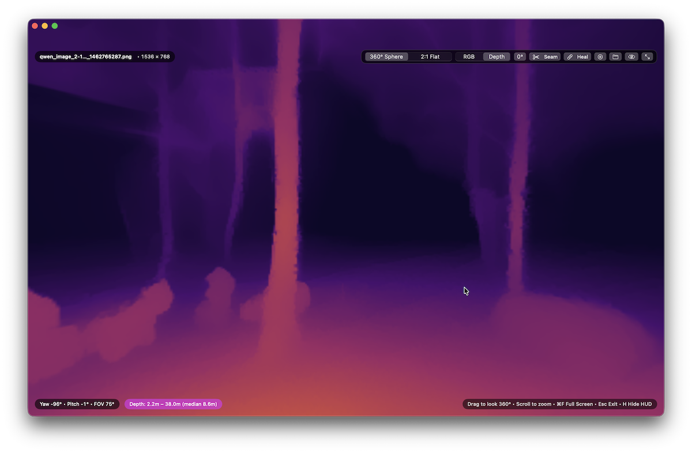
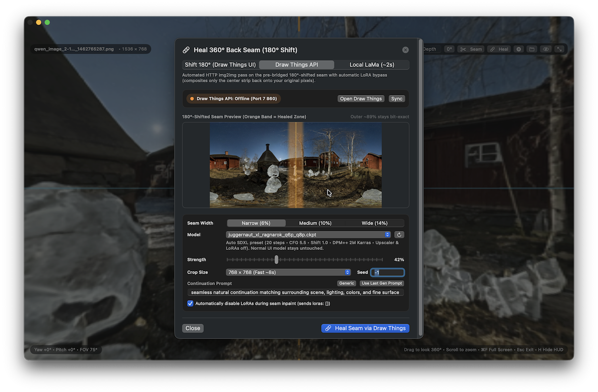
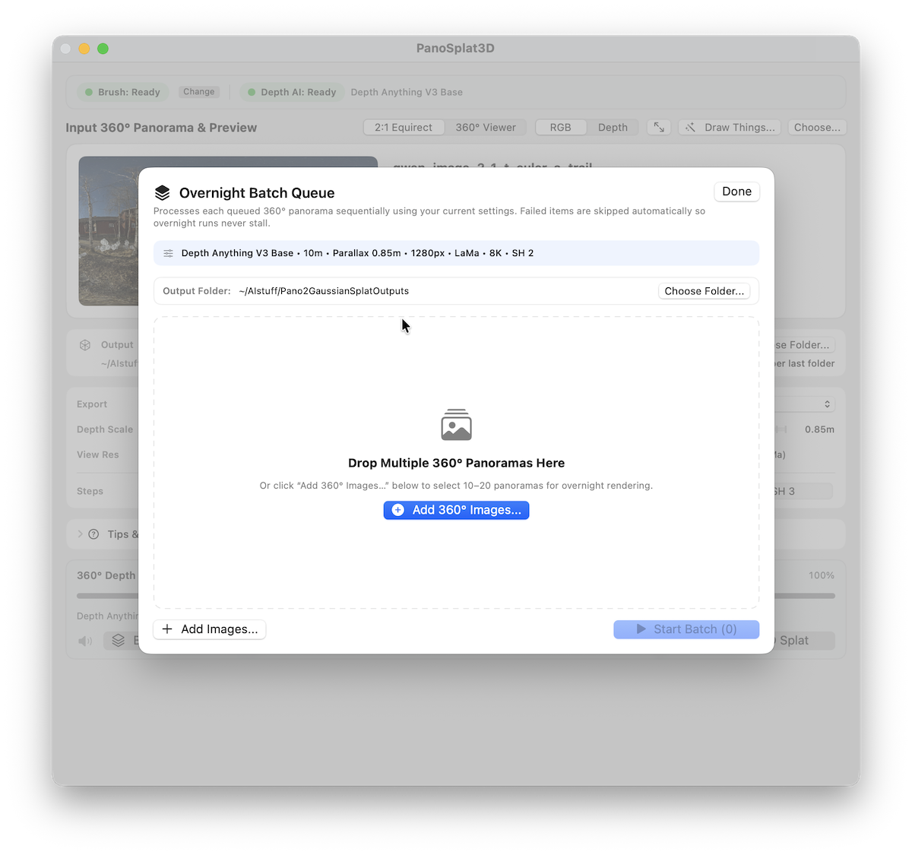
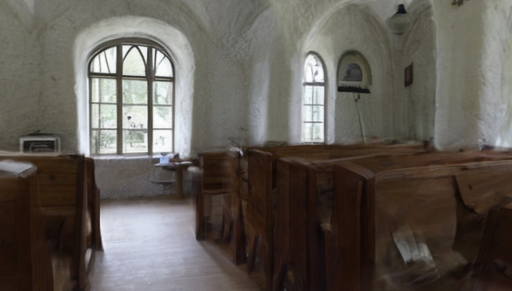

# PanoSplat3D

A 100% native Apple Silicon macOS application (**Swift 6**, **SwiftUI**, **Metal**, **CoreML**) that converts **2:1 equirectangular 360° panoramas** (`.png`, `.jpg`, HDR `.exr`) into parallax-enabled **3D Gaussian Splatting (`.ply`)** environments ready for **SuperSplat**, **Unreal Engine 5.8**, **RadianceView**, **SplatScene**, and **Assimilate Live FX** — with zero Terminal commands and zero Python runtime.


---

## Key Features

- **100% Native macOS Experience** — Drag-and-drop onto the window, Dock icon, or Finder *Open With*; native `NSOpenPanel` / `NSSavePanel` dialogs; **Remember last folder** persistence; and full multi-step **Edit → Undo (`⌘Z`) / Redo (`⇧⌘Z`)**.
- **Three Selectable CoreML Depth Models** — Auto-downloads and caches models in `~/Library/Application Support/PanoSplat3D/Models/`:
  - **Depth Anything V2 Small** (~50 MB, fastest on Apple Neural Engine)
  - **Depth Anything V3 Base** (~233 MB, square `504×504`, cleaner 3D geometry)
  - **Apple Depth Pro 1536px** (~745 MB, ultra-sharp foliage & thin branches)
  - Uses wide-FOV horizon-anchored spherical stitching with unbiased least-squares alignment and circular-wrap RGB-guided edge refinement.
- **True 3D Parallax + CoreML LaMa Void Filling** — Renders **44 views** (`20` center views + `24` two-ring offset parallax views) on a Metal Z-buffer with ground-aware triangle preservation, 2-layer occluder background seeding, eroded disocclusion `masks/`, and optional **CoreML LaMa** (~206 MB) background void inpainting.
- **360°-Wrap-Safe Multi-Model CoreML AI Upscaler** — Circularly wraps tile extraction and blending across the `0°/360°` border so no vertical seam is created:
  - **RealPLKSR 2× Natural** *(MIT, default)* — organic detail on moss, bark, rocks, and water without waxy GAN artifacts
  - **4xNomosWebPhoto** *(CC-BY-4.0)* — real-photography super-resolution (`4× → 2×`)
  - **Real-ESRGAN x4+** *(BSD-3-Clause)*
  - Includes an **AI Detail Strength** blend slider (`50%–100%`), 1-click A/B testing (`Original` vs `Upscaled`), and native `.png` / `.jpg` export.
- **Interactive Metal 360° & Depth Viewer** — Inspect RGB and estimated 360° Metric Depth (`D`) in windowed or true edge-to-edge fullscreen (`⌘F`, `H` to hide HUD, `0` to recenter, `Back Seam 180°` guide).
- **180°-Shift 360° Seam Healing** — Rolls the panorama 180° to center the wrap seam while keeping outer pixels bit-exact via **Draw Things HTTP API** (auto SDXL / FLUX.2 Klein / SD 1.5 presets & LoRA bypass), **Fast Local CoreML LaMa (~2s)**, or **1-Click Clipboard / File 180° Round-Trip**.
- **Draw Things Text-to-360° Integration** — Prompt and pull 2:1 panoramas directly from Draw Things' local HTTP server (`127.0.0.1:7860`).
- **Overnight Batch Processing Queue (`⌘B`)** — Drop 10–20+ panoramas to render sequentially overnight using your active settings, with collision-safe output naming and fault-tolerant skipping.
- **Headless Brush 3DGS Training & 3D Preview** — Automatically discovers `Brush.app` or `brush_app`, streams real-time step progress, splat counts, and ETA (`5K / 8K / 15K` steps, `SH 1 / 2 / 3`), plays completion alerts, and opens an interactive 3D point/Gaussian preview.

---

## Screenshots

| Interactive 360° Viewer (`360° Sphere`) | 360° Metric Depth Inspection (`Depth`) |
| :---: | :---: |
|  |  |

| 180°-Shift Seam Healing | Overnight Batch Queue (`⌘B`) |
| :---: | :---: |
|  |  |

### Trained 3D Gaussian Splat Output


---

## Requirements & Quick Build from Source

- **macOS 15.0+** on **Apple Silicon (`arm64`)**
- **Xcode 16+** / **Swift 6.0+**
- **[Brush](https://github.com/ArthurBrussee/brush)** — If Brush is not already installed on your Mac, PanoSplat3D offers a 1-click **`Install Brush (~40 MB)`** button right in the top status bar (downloads the official Apple Silicon release into `~/Library/Application Support/PanoSplat3D/Tools/brush_app`), or you can locate an existing `Brush.app` / `brush_app` binary via the native file picker.

```bash
# 1. Run unit & Metal integration tests
swift test

# 2. Build, bundle Metal shaders/sounds/icon, and sign PanoSplat3D.app
./Scripts/build_app.sh

# 3. Launch
open PanoSplat3D.app

# Optional: Package a distributable .dmg (without Brush bundled)
./Scripts/build_dmg.sh
```

See **[USER_GUIDE.md](USER_GUIDE.md)** for the complete step-by-step workflow manual, parameter tuning table, and Virtual Production import notes.

---

## Acknowledgements

- **[Brush](https://github.com/ArthurBrussee/brush)** by Arthur Brussee for Metal/Burn 3D Gaussian Splatting training (see [LICENSE](LICENSE) and [CHANGELOG.md](CHANGELOG.md))
- **[Depth Anything V2 Small (CoreML)](https://huggingface.co/apple/coreml-depth-anything-v2-small)** (Apple), **[Depth Anything 3 Base (CoreML)](https://huggingface.co/mlboydaisuke/Depth-Anything-3-Base-CoreML)**, and **[Apple Depth Pro (CoreML)](https://huggingface.co/KeighBee/coreml-DepthPro)**
- **[LaMa-CoreML](https://huggingface.co/mlboydaisuke/LaMa-CoreML)** (Apache-2.0) for parallax void & seam inpainting
- **[RealPLKSR CoreML](https://huggingface.co/gumka/realplksr-coreml)** (MIT), **[4xNomosWebPhoto RealPLKSR](https://huggingface.co/333i/4xNomosWebPhoto_RealPLKSR-coreml-ios)** (CC-BY-4.0, Philip Hofmann), and **[Real-ESRGAN CoreML](https://huggingface.co/arraypress/upscale-realesrgan)** (BSD-3-Clause)
